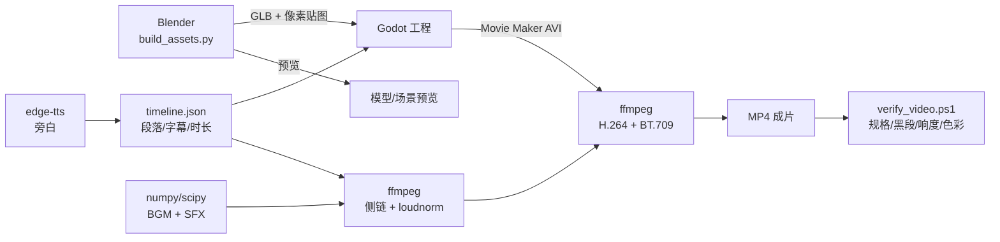

# video_via_blender & godot

**用 Blender 程序化建模 + Godot 4 实时导演，制作体素风格产品视频的完整开源方法。**

示例成片：丽天智能 MMR 光伏组件安装机器人 · 体素化原创演绎（1920×1080 / 30fps / 87.7s）。
当前版本 **v1.4.1**：恢复 v1.3.1 的经典 10 镜头语言，保留 v1.4.0 的黄金时刻灯光、
机械/材质细节、同步音效与 BT.709 自动验收；新增关键节点可见性审计。
成片与媒体仅作展示，**不开源**：见下方「开源范围」。

另有一支同管线制作的《萌兽峡谷 TapArena》30 秒宣传片（体素演绎，含一段游戏实录）：
[▶ taparena-promo-v1.0](https://github.com/sctale/video_via_blender_godot/releases/tag/taparena-promo-v1.0)

[▶ 示例成片（Release）](https://github.com/sctale/video_via_blender_godot/releases/tag/v1.4.1) ·
[下载视频](https://github.com/sctale/video_via_blender_godot/releases/latest) ·
[实现记录（SPEC v1.2）](specs/SPEC-v1.2.0.md) ·
[修正记录（SPEC v1.2.1）](specs/SPEC-v1.2.1.md) ·
[料车重做（SPEC v1.3.0）](specs/SPEC-v1.3.0.md) ·
[标注引线修正（SPEC v1.3.1）](specs/SPEC-v1.3.1.md) ·
[电影化升级（SPEC v1.4.0）](specs/SPEC-v1.4.0.md) ·
[经典镜头恢复（SPEC v1.4.1）](specs/SPEC-v1.4.1.md)


---

## 开源范围（重要）

| 内容 | 许可 |
| --- | --- |
| 代码、脚本、工具、文档（本仓库全部源码） | **MIT**（可学习、修改、商用） |
| 示例视频、海报、截图、3D 模型、贴图、旁白、音乐等媒体 | **All Rights Reserved**（仅观看/演示，**不允许二次创作、再分发或商用**） |
| LEAPTING / 丽天智能 名称与标识 | 权利人为其所有者；本项目为独立技术演示，非官方产品视频 |
| Fusion Pixel Font（像素字体） | MIT，© 2022 TakWolf，见 `licenses/` |

- 本仓库**只放制作方法**，不包含渲染成片与演示媒体；成片只作为 Release 资产发布。
- 用本管线渲染出的示例媒体版权保留；代码 MIT 不代表成片可以二次创作或再发布。
- 详见 [LICENSE](LICENSE)、[LICENSE-DEMO.md](LICENSE-DEMO.md) 与 [NOTICE.md](NOTICE.md)。

---

## 为什么用 Godot 渲染视频

- **Blender**：可复现的程序化资产——体素机器人、组件、支架、像素贴图、GLB 导出。
- **Godot 4**：场景、灯光、`Animation`/脚本动画、两连杆 IK、镜头调度、字幕/HUD、
  Movie Maker 离线逐帧渲染。
- **edge-tts / numpy / scipy / ffmpeg**：中文旁白、原创分层 BGM、同步机械音效、
  侧链混音、两遍 loudnorm 与 H.264/BT.709 压制。
- 全流程脚本化：改台词、改时长、改镜头、改模型都能重跑，不依赖手工剪辑。

## 管线



## 快速开始（Windows）

前置：Blender 4.5+、Godot 4.7+、Python 3.10+、ffmpeg/ffprobe 在 PATH，联网（edge-tts）。

```powershell
git clone https://github.com/sctale/video_via_blender_godot.git
cd video_via_blender_godot
pip install -r requirements.txt

# 首次：生成标识贴图 → Blender 资产 → 旁白/时间轴 → BGM/SFX → 混音 → Godot 导入
powershell -ExecutionPolicy Bypass -File tools\first_run.ps1

# 之后：只重渲（复用资产；默认重做音频，-SkipAudio 可跳过）
powershell -ExecutionPolicy Bypass -File tools\render_video.ps1

# 只出关键静帧与 contact sheet（不渲全片）
powershell -ExecutionPolicy Bypass -File tools\preview_stills.ps1
```

也可以双击：

- `首次生成并渲染.cmd`：完整首次流程 + 出片
- `一键生成视频.cmd`：仅重渲

手动等价命令：

```bash
python tools/make_logo.py
blender -b --factory-startup --python blender/build_assets.py
python tools/gen_narration.py
python tools/make_bgm.py
python tools/make_sfx.py
python tools/mix_audio.py
godot --headless --path godot --import
godot --path godot --fixed-fps 30 --write-movie build/final.avi
ffmpeg -y -i godot/build/final.avi -i audio/mix.m4a -map 0:v:0 -map 1:a:0 \
  -vf "scale=in_range=full:out_range=tv:out_color_matrix=bt709,format=yuv420p" \
  -c:v libx264 -preset slow -crf 18 -pix_fmt yuv420p -profile:v high -level 4.1 \
  -color_range tv -colorspace bt709 -color_primaries bt709 -color_trc bt709 \
  -bsf:v "h264_metadata=colour_primaries=1:transfer_characteristics=1:matrix_coefficients=1" `
  -movflags +faststart -c:a aac -b:a 192k -ar 48000 -frames:v 2630 -shortest installation-robot-v1.4.1.mp4
powershell -ExecutionPolicy Bypass -File tools\verify_video.ps1 -Version 1.4.1
```

## 目录

```
blender/build_assets.py        # 程序化建模 + 像素贴图 + GLB 导出 + 预览渲染
godot/
  project.godot                # 1920×1080、Forward+、4xMSAA + FXAA、Movie Maker 30fps
  scenes/Main.tscn
  scripts/Main.gd              # 场景搭建、两连杆 IK、经典 10 镜头、机械动画、时间轴
  scripts/HUD.gd               # 字幕/步骤条/标注/对位 HUD/片尾卡
  shaders/cinematic.gdshader   # 暗角/细颗粒/轻暖调（不作用于 HUD）
  assets/fonts/                # 像素字体（MIT）
tools/
  make_logo.py                 # 品牌贴图（示例媒体，ARR）
  gen_narration.py             # edge-tts 分段旁白 + timeline.json
  make_bgm.py                  # numpy/scipy 原创分层 BGM
  make_sfx.py, sfx_cues.json   # 同步机械/环境音效与事件表
  mix_audio.py                 # 逐段人声归一 + BGM/SFX 侧链 + 两遍 loudnorm
  make_contact_sheet.py        # 带时间标签的静帧 contact sheet
  preview_stills.ps1           # 关键时间点静帧预览（-Audit 输出节点可见性）
  render_video.ps1             # 终渲 + BT.709 压制 + 抽帧 + 自动验收
  verify_video.ps1             # 规格/黑段/EBU R128/色彩标记检查
  first_run.ps1                # 首次完整生成
specs/SPEC.md, specs/SPEC-v1.1.0.md, specs/SPEC-v1.2.0.md, specs/SPEC-v1.2.1.md, specs/SPEC-v1.3.0.md, specs/SPEC-v1.3.1.md, specs/SPEC-v1.4.0.md, specs/SPEC-v1.4.1.md  # 目标/分段/验收/实现记录
docs/release-notes-v1.0.0.md, docs/release-notes-v1.1.0.md, docs/release-notes-v1.2.0.md, docs/release-notes-v1.2.1.md, docs/release-notes-v1.3.0.md, docs/release-notes-v1.3.1.md, docs/release-notes-v1.4.0.md, docs/release-notes-v1.4.1.md  # Release 说明
```

首次运行后，会生成（已被 `.gitignore` 排除、不属于本仓库源码）：

```
blender/textures/              # 像素贴图（含示例品牌贴图，ARR）
godot/assets/models/*.glb      # 机器人/组件/轨道/道具
godot/assets/textures/         # sand.png / sand_normal.png / track.png
godot/data/timeline.json       # 旁白时长校准后的时间轴
audio/                         # 旁白 mp3 / bgm.wav / sfx.wav / mix.m4a
```

## 实现要点

### 1. 体素资产：Blender 程序化生成

`blender/build_assets.py` 用 Python 直接构建：

- 机器人关节层级固定命名：`Chassis / Turret / ArmLower / ArmUpper / Wrist /
  EffectorYaw / Effector / Grip`，供 Godot 直接驱动。
- 贴图全部 numpy 生成（16–256px）；模型贴图保持 Nearest，沙地使用多尺度纹理 + 法线，
  组件电池片使用更细的母线与金属边框反光。
- 角色/品牌贴花用平面 decal，白色底与白车身一致，避免透明排序问题。
- 同一脚本导出机器人、组件、纵向阵列、空轨道排、沙块、云、岩石、工人、可牵引随行料车。

### 2. Godot：解析 IK + 导演时间轴

- 机械臂用**两连杆解析 IK**：镜头/动作只写吸盘目标点（柱坐标 `yaw/d/h/pitch`），
  每帧解肩/肘/腕角度，避免手调关节角。
- 组件始终**纵向**抱持：`EffectorYaw.rotation.y = -turret_yaw` 让吸盘架绕自身法线反向旋转，
  落板时组件长边沿 20° 坡面、短边沿阵列方向。
- `pose_keys` 定义抓取、抬升、回转、对位、落板、换位；`events` 处理“吸附/释放”；
  切换面板可见性并由 `grip.global_transform` 无缝接管落板姿态。
- 镜头由 `shots` 描述（位置/目标/FOV/跟随/轨道）；v1.4.1 恢复 v1.3.1 的经典 10 镜头，
  保留 v1.4.0 的画质与声音升级，并增加 `CAMERA_AUDIT=1` 关键节点可见性检查。

### 3. 字幕与 HUD

- `timeline.json` 由旁白实测时长生成，Godot 在运行时加载，驱动字幕、步骤条与段落时长。
- HUD 使用 `camera.unproject_position()` 把 3D 锚点投到 2D 做设备标注；
  对位环节绘制面板四角括号、ΔX/ΔZ/Δθ 读数与锁定状态。
- 像素字体只使用 12 的整数倍字号，并关闭抗锯齿，保证锐利。

### 4. Movie Maker 出片（关键坑）

- **尺寸**：Movie Maker 按窗口尺寸出片；`project.godot` 中
  `window_width_override/height_override = 1920/1080`。
- **帧率**：必须加 `--fixed-fps 30`（否则默认 60fps）；剧情时长按秒累积。
- **路径**：`--write-movie build/final.avi` 是**相对 Godot 工程目录**的路径。
- **音频**：Movie Maker 的 AVI 会附带一条**静音 PCM 轨**；ffmpeg 必须
  `-map 0:v:0 -map 1:a:0` 显式使用 `audio/mix.m4a`，否则成片会静音。
- **验证**：`render_video.ps1` 会抽 poster / contact sheet，并调用 `verify_video.ps1`
  检查分辨率、帧数、像素格式、BT.709 标记、黑段与 EBU R128 响度。

## 定制指南

| 想改什么 | 改哪里 |
| --- | --- |
| 旁白台词、字幕、段落时长 | `tools/gen_narration.py` → 重新生成 `godot/data/timeline.json` |
| 动作关键帧、镜头、事件 | `godot/scripts/Main.gd` 的 `pose_keys` / `shots` / `events` |
| 模型、配色、贴图、道具 | `blender/build_assets.py` + `blender/textures/` |
| 字幕/步骤条/标注/HUD | `godot/scripts/HUD.gd` |
| BGM 氛围 | `tools/make_bgm.py` |
| 机械/环境音效与同步点 | `tools/make_sfx.py` + `tools/sfx_cues.json` |
| 出片规格 | `godot/project.godot`、`tools/render_video.ps1` |

## 已知限制

- 示例为体素化原创演绎，不是 1:1 工业还原；片头已注明“动画为原创示意”。
- `edge-tts` 需要联网；不同网络/语音参数会使旁白时长变化，务必重新生成时间轴。
- Windows 脚本（`.ps1/.cmd`）为主；macOS/Linux 可按“手动等价命令”逐条执行。
- 模型贴图使用 Nearest 保持体素观感；沙地法线与组件细节使用线性过滤，避免远景闪烁。

## 许可

- 源码/文档：**MIT**，见 [LICENSE](LICENSE)。
- 示例视频与媒体：**All Rights Reserved**，见 [LICENSE-DEMO.md](LICENSE-DEMO.md)。
- 第三方与商标：见 [NOTICE.md](NOTICE.md)（含像素字体 MIT 许可）。

示例成片与媒体**不允许二次创作、再分发或商用**；代码与方法可自由学习与改造。
